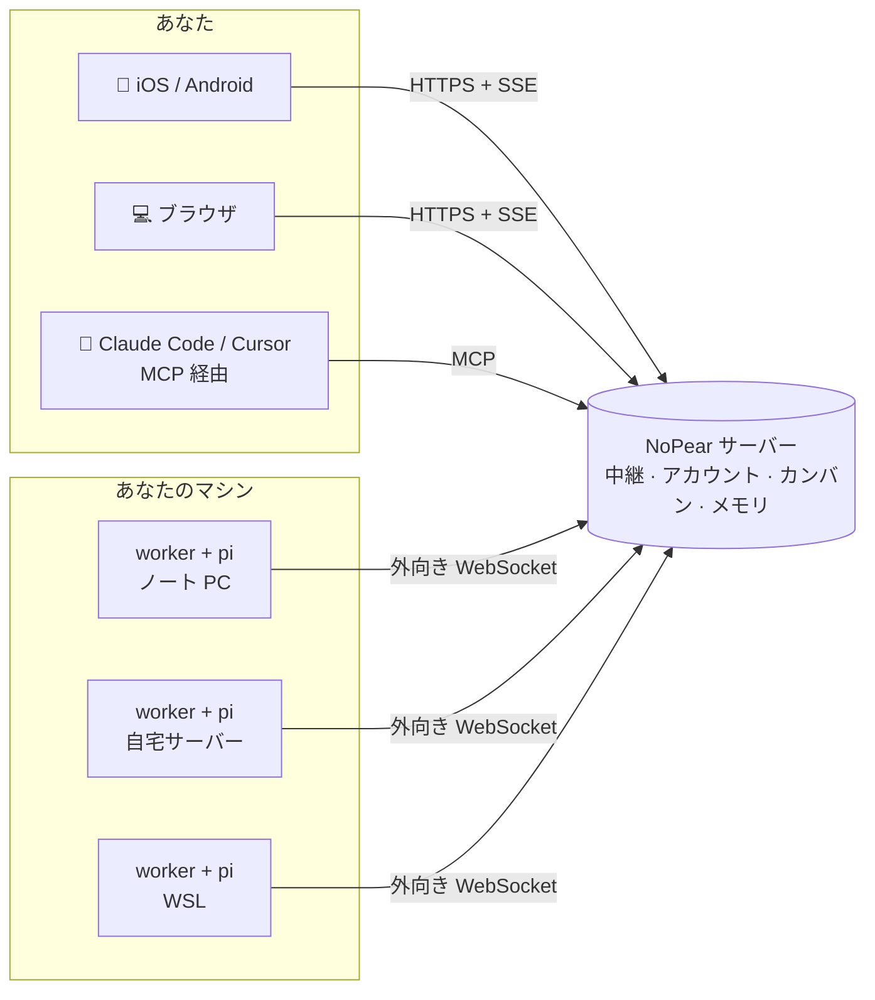

<div align="center">


# NoPear

**コーディングエージェントは自分のマシンで。操作はスマホから。**

どのパソコンでもセッションを始めて、作業の様子をリアルタイムで見て、ソファから返信。<br/>
カンバンで、手元のすべてのマシンにタスクを振り分けられます。

[](LICENSE)
[](https://github.com/callmemhz/nopear/stargazers)


[English](README.md) · [简体中文](README.zh-CN.md) · **日本語**


</div>

---

デスクトップで大きなリファクタリングを走らせたまま電車に乗ったら、エージェントが質問を投げてきた。
NoPear なら、すべてのマシンのすべてのエージェントセッションにワンタップで届きます。**VPN も、ポート開放も、スマホのキーボードで SSH を打つ必要もありません。**

## ✨ 特長

- **📱 ブラウザ上のターミナルではなく、本物のモバイルアプリ。** iOS / Android ネイティブクライアントで、ストリーミング応答、思考過程、ツール呼び出し、追加メッセージのキュー、中断、巻き戻し、フォークに対応。エージェントが送ってきたファイル（HTML ゲーム、動画、PDF、画像）はアプリ内でそのまま開けます。
- **🖥️ すべてのマシンを一つの受信箱に。** ノート PC、自宅サーバー、机の下の GPU マシン。すべてのセッションが一つの一覧に並びます。各マシンでは小さな worker が**外向きに接続するだけ**なので、NAT の内側でも動き、何も公開する必要はありません。
- **🗂️ 自分で仕事をこなすカンバン。** カードをあるマシンの「未着手」列にドラッグすると、そのマシンがカードの内容でセッションを始めます。終わるとカードは「レビュー待ち」へ。マシンごとのキューで、同時実行数も制限できます。
- **🧠 共有メモリ。** アカウント全体とプロジェクトごとのメモが、プロジェクトタグ付きのセッションに注入されます。エージェント自身も更新できます。
- **🔌 好きなモデルを使える。** [pi](https://github.com/earendil-works/pi-mono) エージェントランタイム上で動作します。**Claude Pro/Max や ChatGPT のサブスクリプション**をそのまま使えるほか、Anthropic、OpenAI、Gemini、Bedrock、OpenRouter、DeepSeek、xAI、Groq、ローカルの OpenAI 互換サーバーなどの API キーにも対応。認証情報がマシンの外に出ることはありません。
- **🔐 エンドツーエンド暗号化（任意）。** スイッチ一つで、中継サーバーには暗号文しか見えなくなります（X25519 + AEAD）。マシンを「暗号文のみ」に固定すれば、確実な保証になります。
- **🤝 エージェント同士が連携。** セッションは他のマシンのセッションを一覧・閲覧・開始でき、カードの作成やメモリの編集もできます。同じツールが **MCP** でも公開されているので、Claude Code や Cursor からもあなたのマシン群に仕事を振れます。
- **🪄 細かいところまで。** ワンライナーインストール（macOS / Linux / WSL2）と自動登録、セッションタイトルの自動生成、モデルの上限に達する前の自動コンテキスト圧縮、画像の WebP 統一、カーソルから再開できる同期。

## 📸 スクリーンショット

<table>
  <tr>
    <td width="33%"></td>
    <td width="33%"></td>
    <td width="33%"></td>
  </tr>
  <tr>
    <td align="center"><sub>すべてのマシン、すべてのセッション</sub></td>
    <td align="center"><sub>スマホでライブ表示</sub></td>
    <td align="center"><sub>エージェントが作ったばかりのゲームをアプリ内でプレイ</sub></td>
  </tr>
</table>

**カンバン：マシンごとに「未着手」キュー。カードは自動で実行され、「レビュー待ち」で止まります。**


**本物のツール呼び出しと本物の出力。どのステップも展開して、実際に何が実行されたかを確認できます。**


**コマンド一行でマシンを追加。自動であなたのアカウントに登録されます。**


## 🧭 仕組み



- **サーバー**（`saas/`）：アカウント、マシン登録、データの中継、カンバン／プロジェクト／メモリ、MCP エンドポイント、Web アプリ。Fastify + SQLite のコンテナ一つで動きます。
- **worker**（`worker/`）：使いたい各マシンで動き、エージェントセッションをホストします。**外向き**の WebSocket を張るだけなので、どこからでも使えます。
- **クライアント**：Web アプリ（`web/`、React）とモバイルアプリ（`mobile/`、Expo）。同期エンジン（`packages/core`）を共有しています。

## 🚀 クイックスタート

**Node ≥ 22.13** と、[pi](https://github.com/earendil-works/pi-mono) をセットアップ済みのマシン（`pi` を起動して `/login`、または API キー）が必要です。

### 1. サーバーを動かす

```bash
git clone https://github.com/callmemhz/nopear && cd nopear
docker build -t nopear .
docker run -d --name nopear -p 8790:8790 -v nopear-data:/data \
  -e SAAS_PUBLIC_URL=https://nopear.example.com \
  -e GOOGLE_CLIENT_ID=... -e GOOGLE_CLIENT_SECRET=... \
  -e SAAS_BOOTSTRAP_ADMIN=you@example.com \
  nopear
```

ログインは Google OAuth です（コールバック `https://<あなたのホスト>/api/auth/google/callback`）。`SAAS_BOOTSTRAP_ADMIN` でログイン許可リストが有効になり、あなたが管理者になります。他の人は「設定 → メンバー」で追加してください。前段には WebSocket（`/worker/connect`）を通し、SSE をバッファしない TLS リバースプロキシを置きます。`/data` は永続ボリュームに置き、インスタンスは一つだけ動かしてください（SQLite）。

<details>
<summary>手元で試すだけなら：Docker も Google ログインも不要です。</summary>

```bash
npm install
npm run build -w @nopear/web
SAAS_DEV_LOGIN=1 npm start -w @nopear/saas          # http://localhost:8790、任意のメールアドレスでログイン
NOPEAR_SAAS_URL=http://localhost:8790 npm start -w @nopear/worker
```

worker は初回起動時に登録用リンクと QR コードを表示します。ログイン済みのブラウザで開くと、そのマシンが追加されます。
`SAAS_DEV_LOGIN` はメールアドレスだけでログインできてしまうので、**公開サーバーでは絶対に有効にしないでください**。
</details>

### 2. マシンをつなぐ

Web アプリで「マシン → マシンを追加」を開き、表示されたコマンドを新しいマシンで実行します。

```bash
curl -fsSL 'https://nopear.example.com/install.sh?code=…' | bash
```

必要に応じて Node と pi をインストールし、worker をバックグラウンドサービスとして登録し（macOS は launchd、Linux / WSL2 は systemd）、マシンをあなたのアカウントに登録します。あとはそのマシンで `pi` からモデルにログインすれば完了です。

### 3. スマホアプリ

モバイルアプリは `mobile/`（Expo）にあります。ご自身の Apple / Google 開発者アカウントでビルドしてください。

```bash
cd mobile
NOPEAR_SAAS_URL=https://nopear.example.com NOPEAR_IOS_BUNDLE_ID=com.you.nopear \
NOPEAR_APPLE_TEAM_ID=XXXXXXXXXX npx expo run:ios --device --configuration Release
```

無料の個人 Apple チームの場合は、`expo prebuild` の後にプッシュ通知の entitlement を削除してください（個人チームでは署名できません）。アプリをビルドする準備がなくても、Web アプリはスマホのブラウザで快適に使えます。

## 🔐 セキュリティモデル（必ずお読みください）

NoPear はコードを実行するマシンのリモートコントロールです。それにふさわしく扱ってください。

- **エージェントはツール呼び出しを確認なしで実行します。** あなたのアカウントとして操作できる人は誰でも、あなたのマシンで任意のコマンドを実行できます。信頼できるマシンとアカウントでのみ worker を動かし、できれば隔離環境やサンドボックスを使ってください。
- **既定ではサーバーを信頼します。** E2E が**オフ**（既定）のとき、サーバーはセッションを読み取り、操作できます。マシンをまたぐツールはこれで動いています。E2E を**オン**にすると誠実なサーバーには暗号文しか見えませんが、侵害されたサーバーは設定を戻せます。worker で `NOPEAR_E2E=required` を設定すれば、そのマシンのデータについては確実に保証されます。
- **カンバンの配布は E2E の対象外です。** MCP トークンを持つ人、あるいはどのエージェントセッション（プロンプトインジェクションを受けたものを含む）でも、マシンのキューにカードを入れられ、そのマシンはそれを実行します。トークンは厳重に管理し、使わないものは削除してください。
- **共有メモリはタグ付きセッションに注入され**、エージェントも編集できます。ときどき内容を確認してください。
- **ログイン許可リスト。** 「設定 → メンバー」で有効にすると、リストに載せた人だけがログインできます。

## ⚙️ 設定

<details>
<summary><b>サーバー</b>の環境変数</summary>

| 変数 | 既定値 | 説明 |
|---|---|---|
| `SAAS_PORT` | `8790` | 待ち受けポート |
| `SAAS_PUBLIC_URL` | リクエスト元 | 登録リンク、OAuth コールバック、インストールコマンドに使う公開 URL |
| `SAAS_DATA_DIR` | `./.saas` | SQLite データベースと自動生成される鍵 |
| `SAAS_SIGNING_KEY` | 自動生成 | プラットフォームの Ed25519 鍵。全 worker がこれを固定します：**必ずバックアップ** |
| `SAAS_SESSION_SECRET` | 自動生成 | ログインセッションの秘密鍵 |
| `GOOGLE_CLIENT_ID` / `GOOGLE_CLIENT_SECRET` | – | Google ログイン |
| `SAAS_DEV_LOGIN` | `0` | `1` = メールアドレスだけでログイン（**ローカル開発専用**） |
| `SAAS_BOOTSTRAP_TOKEN` | – | worker の登録にこのトークンを要求 |
| `SAAS_BOOTSTRAP_ADMIN` | – | 許可リストが空のとき、最初の管理者にするメールアドレス |
| `SAAS_REDIRECT_ALLOWLIST` | `nopear://` | モバイルアプリに許可する OAuth リダイレクト |
| `SAAS_BODY_LIMIT_MB` | `64` | リクエストボディの上限 |
| `SAAS_WEB_DIR` | `../web/dist` | 配信する Web のビルド |
| `SAAS_WORKER_TGZ` | – | インストーラー用の worker パッケージ（Docker イメージで設定済み） |
</details>

<details>
<summary><b>worker</b> の環境変数</summary>

| 変数 | 既定値 | 説明 |
|---|---|---|
| `NOPEAR_SAAS_URL` | 必須 | サーバーの URL |
| `NOPEAR_HOME` | `~/.nopear` | ID、セッション、ファイルキャッシュ |
| `NOPEAR_LABEL` | ホスト名 | アプリに表示されるマシン名 |
| `NOPEAR_DEFAULT_CWD` | `$HOME` | 新しいセッションの既定の作業ディレクトリ |
| `NOPEAR_DEFAULT_MODEL` | 最初に使えるモデル | pi の `models.json` にある `provider/modelId` |
| `NOPEAR_DEFAULT_THINKING` | `medium` | 既定の思考レベル |
| `NOPEAR_PI_AUTH` / `NOPEAR_PI_MODELS` | `~/.pi/agent/…` | pi の認証情報とモデル設定 |
| `NOPEAR_PERSONA` | `Claude Code` | エージェントの名乗り |
| `NOPEAR_E2E` | `auto` | `required` = 平文フレームをすべて拒否 |
| `NOPEAR_CARD_WIP` | `1` | このマシンで同時に実行するカード数 |
| `NOPEAR_AUTO_TITLE` | `1` | 最初の返信の後にセッションへタイトルを付ける |
| `NOPEAR_IDLE_DISPOSE_MS` | `600000` | アイドルセッションをメモリから解放するまでの時間 |
| `NOPEAR_ASK_TIMEOUT_MS` | `0` | エージェントからの質問の待ち時間（`0` = 無期限） |
| `NOPEAR_DNS_ORDER` | `ipv4first` | 不安定な IPv6 でトンネルが黙って切れるのを防ぐ。IPv6 のみのホストは `verbatim` |
| `NOPEAR_SAAS_BOOTSTRAP_TOKEN` | – | サーバーの `SAAS_BOOTSTRAP_TOKEN` に対応 |
</details>

アカウント全体の設定は Web アプリで変更します。エンドツーエンド暗号化、**自動コンテキスト圧縮**（既定ではコンテキストが 300k トークンに達したら古い内容を要約するので、長いセッションでもモデルの上限に当たりません）、MCP 用の個人 API トークン。

## 🔌 Claude Code / Cursor から使う（MCP）

「設定 → 個人 API トークン」でトークンを作成し、次のように設定します。

```json
{
  "mcpServers": {
    "nopear": {
      "type": "http",
      "url": "https://nopear.example.com/mcp",
      "headers": { "Authorization": "Bearer <あなたのトークン>" }
    }
  }
}
```

エディタのエージェントから、プロジェクトの一覧、カードの作成・移動、共有メモリの読み書き、どのマシンでのセッション開始・閲覧もできるようになります。

## ❓ よくある質問

**UI は日本語ですか？** まだです。アプリの UI は現在中国語のみです。英語 UI（と多言語対応）は最も歓迎しているコントリビューションです。エージェントはあなたが書いた言語で返信します。

**公開サーバーは必要ですか？** worker がサーバーに届けば十分です。小さな VPS、トンネル経由で公開した自宅サーバー、単一マシンなら `localhost` でも動きます。

**コードや API キーはサーバーを通りますか？** モデルの認証情報は各マシンに残り、モデルへのリクエストは worker からプロバイダーへ直接送られます。セッションの内容は中継を通ります。E2E オフなら平文、オンなら暗号文です。

**Windows は？** WSL2 を使ってください。ワンライナーインストールが対応しています。

## 🛠️ 開発

```bash
npm install
npm run typecheck     # すべての workspace
npm test              # vitest（core / web / mobile）+ node:test（サーバー / worker）
npm run e2e           # 本物のサーバー + 本物の worker + スクリプト化したモデル → "E2E OK"
```

すべての型、RPC、イベント、通信フレームは [`packages/protocol`](packages/protocol/src/index.ts) にあります。プロトコルを変えるときはまずここを変更し、その後で各側を更新してください。

Issue と PR を大歓迎しています。特に**英語 UI / 多言語対応**、公開 Docker イメージ、App Store / Play Store 向けのビルドを募集中です。

## ⭐ Star の推移

NoPear のおかげで机に戻らずに済んだら、Star を付けてもらえると他の人にも見つけてもらいやすくなります。

[](https://star-history.com/#callmemhz/nopear&Date)

## License

[MIT](LICENSE)
