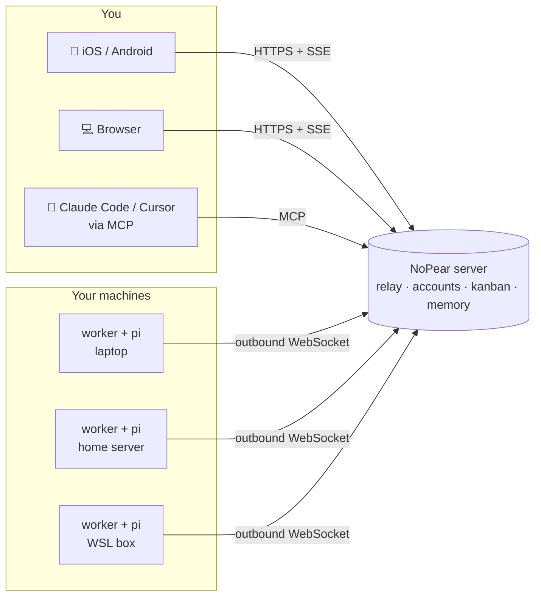

<div align="center">


# NoPear

**Your coding agents run on your machines. Drive them from your phone.**

Start a session on any of your computers, watch it work live, reply from the couch,<br/>
and hand out tasks on a kanban board — across every machine you own.

[](LICENSE)
[](https://github.com/callmemhz/nopear/stargazers)


**English** · [简体中文](README.zh-CN.md) · [日本語](README.ja.md)


</div>

---

You left a long refactor running on your desktop. Now you're on the train and it's asking a question.
NoPear puts every agent session on every machine you own one tap away — **no VPN, no open ports, no SSH from a phone keyboard.**

## ✨ Highlights

- **📱 A real mobile app, not a terminal in a browser.** Native iOS/Android client: streaming replies, thinking, tool calls, queued follow-ups, interrupt, rewind, fork. Files the agent sends — HTML games, videos, PDFs, images — open right inside the app.
- **🖥️ All your machines, one inbox.** Laptop, home server, the GPU box under the desk: every session from every machine in one list. Each machine is just a small worker that **dials out** — works behind NAT, nothing to expose.
- **🗂️ Kanban that actually does the work.** Drag a card into a machine's *To do* column and that machine starts a session on it. When it's done the card lands in *Review*. One queue per machine, with a concurrency limit.
- **🧠 Shared memory.** Account-wide and per-project notes are injected into every tagged session on every machine, and agents can update them.
- **🔌 Bring your own model.** Built on the [pi](https://github.com/earendil-works/pi-mono) agent runtime: use your **Claude Pro/Max or ChatGPT subscription**, or API keys for Anthropic, OpenAI, Gemini, Bedrock, OpenRouter, DeepSeek, xAI, Groq, local OpenAI-compatible servers and more. Credentials never leave the machine.
- **🔐 Optional end-to-end encryption.** Flip one switch and the relay only ever sees ciphertext (X25519 + AEAD). Pin a machine to *encrypted-only* for a hard guarantee.
- **🤝 Agents that coordinate.** Sessions can list, read and start sessions on your other machines, file cards and edit memory. The same tools are exposed over **MCP**, so Claude Code or Cursor can dispatch work to your fleet.
- **🪄 The small stuff, done.** One-line installer (macOS / Linux / WSL2) with auto-claim, automatic session titles, automatic context compaction before the model's limit, images normalised to WebP, offline-friendly sync that resumes from a cursor.

## 📸 Screenshots

<table>
  <tr>
    <td width="33%"></td>
    <td width="33%"></td>
    <td width="33%"></td>
  </tr>
  <tr>
    <td align="center"><sub>Every machine, every session</sub></td>
    <td align="center"><sub>Live session on the phone</sub></td>
    <td align="center"><sub>The game the agent just built, playable in-app</sub></td>
  </tr>
</table>

**Kanban: one *To do* queue per machine. Cards run themselves and stop at *Review*.**


**Real tool calls, real output. Expand any step to see exactly what ran.**


**Add a machine with one command. It claims itself to your account.**


## 🧭 How it works



- **Server** (`saas/`): accounts, machine claiming, the data-plane relay, kanban/projects/memory, the MCP endpoint, and the web app. Fastify + SQLite, one container.
- **Worker** (`worker/`): runs on each machine you want to use and hosts the agent sessions. It only opens an **outbound** WebSocket, so it works from anywhere.
- **Clients**: the web app (`web/`, React) and the mobile app (`mobile/`, Expo). They share one sync engine (`packages/core`).

## 🚀 Quick start

You need **Node ≥ 22.13** and a machine with [pi](https://github.com/earendil-works/pi-mono) set up (`pi` then `/login`, or an API key).

### 1. Run the server

```bash
git clone https://github.com/callmemhz/nopear && cd nopear
docker build -t nopear .
docker run -d --name nopear -p 8790:8790 -v nopear-data:/data \
  -e SAAS_PUBLIC_URL=https://nopear.example.com \
  -e GOOGLE_CLIENT_ID=... -e GOOGLE_CLIENT_SECRET=... \
  -e SAAS_BOOTSTRAP_ADMIN=you@example.com \
  nopear
```

Sign-in is Google OAuth (callback `https://<your host>/api/auth/google/callback`). `SAAS_BOOTSTRAP_ADMIN` turns on the login allowlist with you as admin; add other people in *Settings → Members*. Put it behind any TLS reverse proxy that passes WebSockets (`/worker/connect`) and doesn't buffer SSE. Keep `/data` on a persistent volume, and run a single instance (SQLite).

<details>
<summary>Just trying it locally? No Docker, no Google login.</summary>

```bash
npm install
npm run build -w @nopear/web
SAAS_DEV_LOGIN=1 npm start -w @nopear/saas          # http://localhost:8790, log in with any email
NOPEAR_SAAS_URL=http://localhost:8790 npm start -w @nopear/worker
```

The worker prints a claim link and QR code on first start. Open it while logged in to add the machine.
`SAAS_DEV_LOGIN` lets anyone in with just an email: never enable it on a public server.
</details>

### 2. Connect your machines

In the web app open **Machines → Add machine** and run the command it gives you on the new machine:

```bash
curl -fsSL 'https://nopear.example.com/install.sh?code=…' | bash
```

It installs Node and pi if needed, sets the worker up as a background service (launchd on macOS, systemd on Linux / WSL2) and claims the machine to your account. Then log in to your model provider on that machine with `pi`, and you're done.

### 3. Get the phone app

The mobile app lives in `mobile/` (Expo). Build it with your own Apple / Google developer account:

```bash
cd mobile
NOPEAR_SAAS_URL=https://nopear.example.com NOPEAR_IOS_BUNDLE_ID=com.you.nopear \
NOPEAR_APPLE_TEAM_ID=XXXXXXXXXX npx expo run:ios --device --configuration Release
```

On a free personal Apple team, remove the push-notification entitlement after `expo prebuild` (personal teams can't sign it). Not ready to build an app? The web app works well in a phone browser too.

## 🔐 Security model: please read

NoPear is remote control for machines that run code. Treat it that way.

- **Agents execute tool calls without asking.** Anyone who can act as your account can make your machines run arbitrary commands. Only run a worker on machines and accounts you trust, ideally isolated or sandboxed.
- **The server is trusted by default.** With E2E **off** (the default) the server can read and drive sessions; that is what makes cross-machine tools work. With E2E **on**, an honest server only sees ciphertext, but a compromised one could switch it back. Set `NOPEAR_E2E=required` on a worker for a hard guarantee for that machine's data plane.
- **Kanban dispatch is not covered by E2E.** Anyone holding an MCP token (or any agent session, including a prompt-injected one) can file a card into a machine's queue, and that machine will run it. Guard tokens; delete unused ones.
- **Shared memory is injected into tagged sessions** and agents can edit it. Review it now and then.
- **Login allowlist.** Turn it on in *Settings → Members* so only people you list can sign in.

## ⚙️ Configuration

<details>
<summary><b>Server</b> environment variables</summary>

| Variable | Default | Description |
|---|---|---|
| `SAAS_PORT` | `8790` | Listen port |
| `SAAS_PUBLIC_URL` | request origin | Public URL used for claim links, OAuth callbacks and install commands |
| `SAAS_DATA_DIR` | `./.saas` | SQLite database and generated keys |
| `SAAS_SIGNING_KEY` | generated | Platform Ed25519 key. Every worker pins it: **back it up** |
| `SAAS_SESSION_SECRET` | generated | Login session secret |
| `GOOGLE_CLIENT_ID` / `GOOGLE_CLIENT_SECRET` | – | Google sign-in |
| `SAAS_DEV_LOGIN` | `0` | `1` = log in with just an email (**local development only**) |
| `SAAS_BOOTSTRAP_TOKEN` | – | Require this token to register a worker |
| `SAAS_BOOTSTRAP_ADMIN` | – | First allowlist admin (applied while the allowlist is empty) |
| `SAAS_REDIRECT_ALLOWLIST` | `nopear://` | Allowed OAuth redirects for the mobile app |
| `SAAS_BODY_LIMIT_MB` | `64` | Request body limit |
| `SAAS_WEB_DIR` | `../web/dist` | Web build to serve |
| `SAAS_WORKER_TGZ` | – | Prebuilt worker package for the installer (set in the Docker image) |
</details>

<details>
<summary><b>Worker</b> environment variables</summary>

| Variable | Default | Description |
|---|---|---|
| `NOPEAR_SAAS_URL` | required | Server URL |
| `NOPEAR_HOME` | `~/.nopear` | Identity, sessions, file cache |
| `NOPEAR_LABEL` | hostname | Machine name shown in the apps |
| `NOPEAR_DEFAULT_CWD` | `$HOME` | Default working directory for new sessions |
| `NOPEAR_DEFAULT_MODEL` | first available | `provider/modelId` from pi's `models.json` |
| `NOPEAR_DEFAULT_THINKING` | `medium` | Default thinking level |
| `NOPEAR_PI_AUTH` / `NOPEAR_PI_MODELS` | `~/.pi/agent/…` | pi credentials and model config |
| `NOPEAR_PERSONA` | `Claude Code` | How the agent introduces itself |
| `NOPEAR_E2E` | `auto` | `required` = refuse every plaintext frame |
| `NOPEAR_CARD_WIP` | `1` | Cards this machine runs at once |
| `NOPEAR_AUTO_TITLE` | `1` | Name sessions after their first reply |
| `NOPEAR_IDLE_DISPOSE_MS` | `600000` | Unload idle sessions from memory |
| `NOPEAR_ASK_TIMEOUT_MS` | `0` | Timeout for questions the agent asks you (`0` = wait) |
| `NOPEAR_DNS_ORDER` | `ipv4first` | Avoids silent tunnel drops on flaky IPv6; `verbatim` for IPv6-only hosts |
| `NOPEAR_SAAS_BOOTSTRAP_TOKEN` | – | Matches the server's `SAAS_BOOTSTRAP_TOKEN` |
</details>

Account-wide settings live in the web app: end-to-end encryption, **auto-compaction** (summarise old context at 300k tokens by default, so long sessions never hit the model's limit), and personal API tokens for MCP.

## 🔌 Use it from Claude Code / Cursor (MCP)

Create a token in **Settings → Personal API tokens**, then:

```json
{
  "mcpServers": {
    "nopear": {
      "type": "http",
      "url": "https://nopear.example.com/mcp",
      "headers": { "Authorization": "Bearer <your token>" }
    }
  }
}
```

Your editor's agent can now list projects, file and move cards, read and write shared memory, and start or read sessions on any of your machines.

## ❓ FAQ

**Is the interface in English?** Not yet: the apps are currently Chinese-only. English (and i18n in general) is the most-wanted contribution. Agents reply in whatever language you write to them.

**Do I need a public server?** The workers only need to reach the server. A small VPS, a home server behind a tunnel, or `localhost` for a single machine all work.

**Does my code or API key go through the server?** Model credentials stay on each machine; model calls go straight from the worker to the provider. Session content passes through the relay: in plaintext with E2E off, as ciphertext with E2E on.

**Windows?** Use WSL2: the one-line installer supports it.

## 🛠️ Development

```bash
npm install
npm run typecheck     # every workspace
npm test              # vitest (core / web / mobile) + node:test (server / worker)
npm run e2e           # real server + real worker + scripted model → "E2E OK"
```

All types, RPCs, events and wire frames live in [`packages/protocol`](packages/protocol/src/index.ts). Change the protocol there first, then update each side.

Issues and PRs are very welcome, especially **English UI / i18n**, a published Docker image, and App Store / Play Store builds.

## ⭐ Star history

If NoPear saves you a trip back to your desk, a star helps other people find it.

[](https://star-history.com/#callmemhz/nopear&Date)

## License

[MIT](LICENSE)
