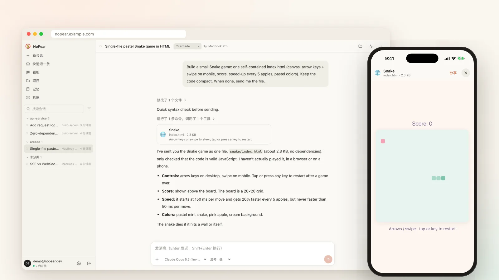
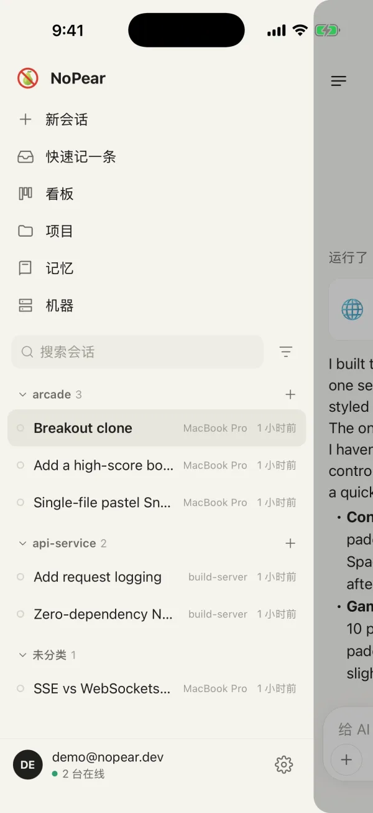
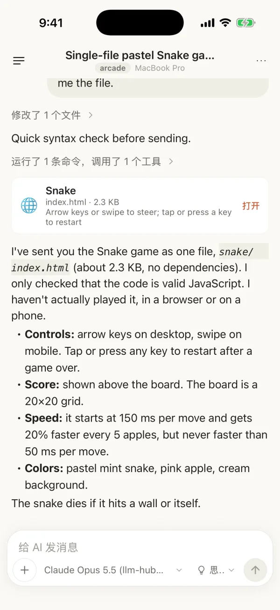
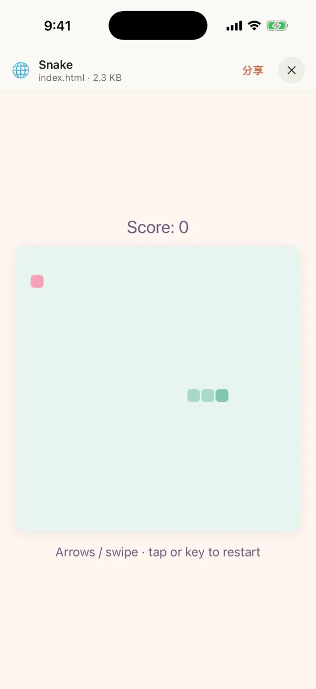
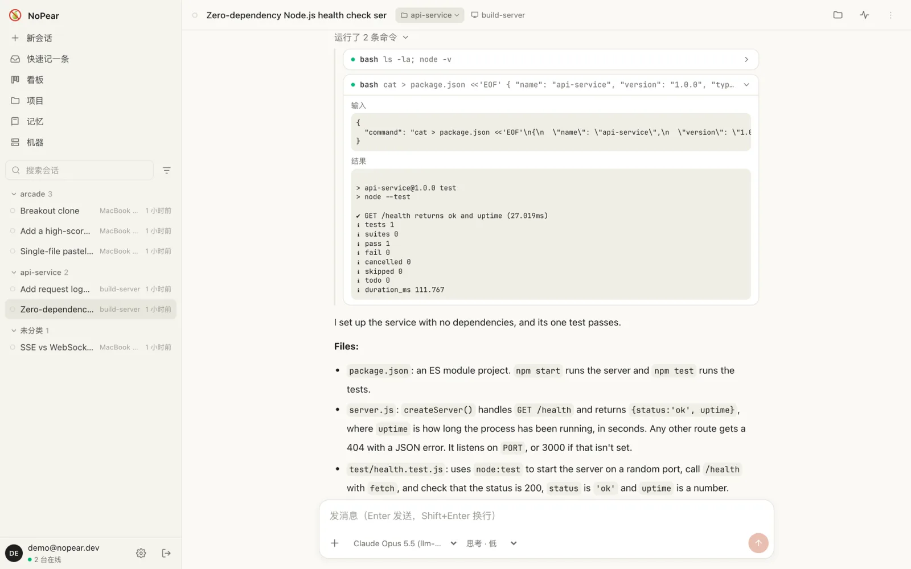
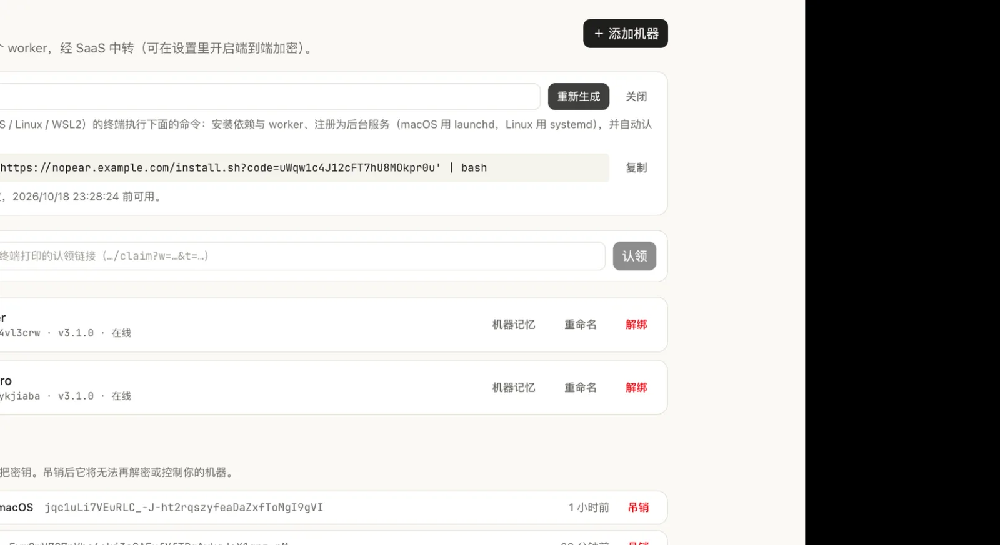
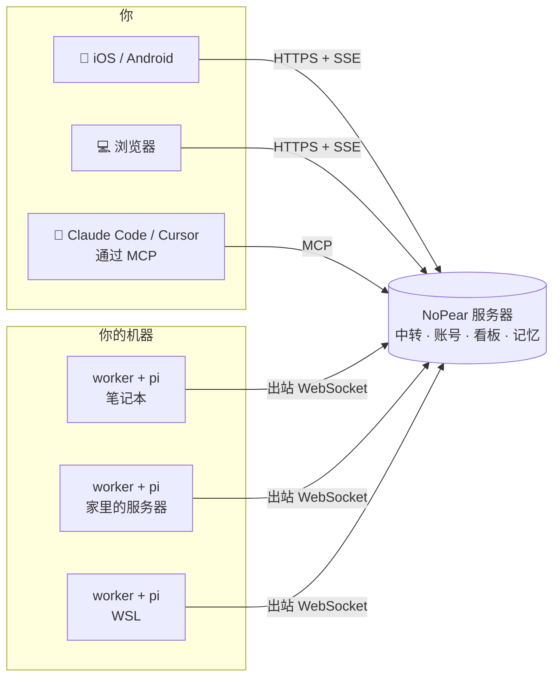

<div align="center">


# NoPear

**coding agent 跑在你自己的机器上，你在手机上指挥它。**

在任意一台电脑上开会话，实时看它干活，躺在沙发上就能回复；<br/>
再用看板把任务派给你所有的机器。

[](LICENSE)
[](https://github.com/callmemhz/nopear/stargazers)


[English](README.md) · **简体中文** · [日本語](README.ja.md)



</div>

---

你在台式机上跑着一个大重构，人已经在地铁上了，它却停下来问你一个问题。
NoPear 让你所有机器上的所有 agent 会话都近在指尖：**不用 VPN，不用开端口，不用在手机键盘上敲 SSH。**

## ✨ 亮点

- **📱 真正的手机 app，不是网页里塞个终端。** 原生 iOS/Android 客户端：流式回复、思考过程、工具调用、排队插话、中断、回退、分叉。agent 发来的文件（HTML 小游戏、视频、PDF、图片）直接在 app 里打开。
- **🖥️ 所有机器，一个收件箱。** 笔记本、家里的服务器、桌下那台 GPU 机器，所有会话合在一个列表里。每台机器只跑一个小 worker，**只往外连**：在 NAT 后面也能用，什么都不用暴露。
- **🗂️ 会自己干活的看板。** 把卡片拖进某台机器的「待开始」列，那台机器就以卡片内容开一个会话去做，做完卡片进「待验收」。每台机器一个队列，可限制并发。
- **🧠 共享记忆。** 账号级和项目级的笔记会注入到每台机器上带项目标签的会话里，agent 也能改写。
- **🔌 自带模型。** 基于 [pi](https://github.com/earendil-works/pi-mono) agent 运行时：可以直接用 **Claude Pro/Max 或 ChatGPT 订阅**，也可以用 Anthropic、OpenAI、Gemini、Bedrock、OpenRouter、DeepSeek、xAI、Groq、本地 OpenAI 兼容服务等的 API key。凭据永远不离开那台机器。
- **🔐 可选端到端加密。** 打开一个开关，中转服务器就只看得到密文（X25519 + AEAD）。还可以把某台机器锁成「只收密文」，硬性保证。
- **🤝 agent 之间能协作。** 会话可以查看、读取、在你其他机器上开会话，也能建卡片、改记忆。同一套工具通过 **MCP** 暴露出来，Claude Code、Cursor 也能给你的机器派活。
- **🪄 细节都做好了。** 一行命令安装（macOS / Linux / WSL2）并自动认领；会话自动起标题；上下文接近上限前自动压缩；图片统一转 WebP；断线后按游标续传。

## 📸 截图

<table>
  <tr>
    <td width="33%"></td>
    <td width="33%"></td>
    <td width="33%"></td>
  </tr>
  <tr>
    <td align="center"><sub>每台机器、每个会话</sub></td>
    <td align="center"><sub>手机上实时看会话</sub></td>
    <td align="center"><sub>agent 刚写好的游戏，在 app 里直接玩</sub></td>
  </tr>
</table>

**看板：每台机器一个「待开始」队列，卡片自己跑，停在「待验收」。**


**真实的工具调用、真实的输出，展开任意一步就能看到到底执行了什么。**


**一条命令接入新机器，并自动认领到你的账号。**


## 🧭 工作原理



- **服务器**（`saas/`）：账号、机器认领、数据中转、看板/项目/记忆、MCP 端点，以及网页版。Fastify + SQLite，一个容器。
- **worker**（`worker/`）：跑在每台你想远程使用的机器上，负责托管 agent 会话。它只建立**出站** WebSocket，在哪都能用。
- **客户端**：网页版（`web/`，React）和手机 app（`mobile/`，Expo），共用一套同步引擎（`packages/core`）。

## 🚀 快速开始

需要 **Node ≥ 22.13**，以及一台配好 [pi](https://github.com/earendil-works/pi-mono) 的机器（运行 `pi` 后 `/login`，或者配 API key）。

### 1. 部署服务器

```bash
git clone https://github.com/callmemhz/nopear && cd nopear
docker build -t nopear .
docker run -d --name nopear -p 8790:8790 -v nopear-data:/data \
  -e SAAS_PUBLIC_URL=https://nopear.example.com \
  -e GOOGLE_CLIENT_ID=... -e GOOGLE_CLIENT_SECRET=... \
  -e SAAS_BOOTSTRAP_ADMIN=you@example.com \
  nopear
```

登录用 Google OAuth（回调地址 `https://<你的域名>/api/auth/google/callback`）。`SAAS_BOOTSTRAP_ADMIN` 会开启登录白名单并把你设为管理员，其他人在「设置 → 成员」里添加。前面要放一层终止 TLS 的反向代理，放行 WebSocket（`/worker/connect`），SSE 不要缓冲。`/data` 务必挂持久卷，并且只跑一个实例（SQLite）。

<details>
<summary>只想在本机试试？不用 Docker，也不用 Google 登录。</summary>

```bash
npm install
npm run build -w @nopear/web
SAAS_DEV_LOGIN=1 npm start -w @nopear/saas          # http://localhost:8790，输入任意邮箱登录
NOPEAR_SAAS_URL=http://localhost:8790 npm start -w @nopear/worker
```

worker 第一次启动会打印认领链接和二维码，在已登录的浏览器里打开就能把这台机器加进来。
`SAAS_DEV_LOGIN` 只凭邮箱就能登录，**绝不要在公网服务器上开启**。
</details>

### 2. 接入你的机器

在网页版打开「机器 → 添加机器」，把生成的命令拿到新机器上执行：

```bash
curl -fsSL 'https://nopear.example.com/install.sh?code=…' | bash
```

脚本会按需安装 Node 和 pi，把 worker 注册成后台服务（macOS 用 launchd，Linux / WSL2 用 systemd），并自动认领到你的账号。最后在那台机器上用 `pi` 登录模型，就可以用了。

### 3. 装手机 app

手机 app 在 `mobile/`（Expo），用你自己的 Apple / Google 开发者账号构建：

```bash
cd mobile
NOPEAR_SAAS_URL=https://nopear.example.com NOPEAR_IOS_BUNDLE_ID=com.you.nopear \
NOPEAR_APPLE_TEAM_ID=XXXXXXXXXX npx expo run:ios --device --configuration Release
```

如果用的是免费的个人 Apple 开发团队，`expo prebuild` 之后要去掉推送通知的 entitlement（个人团队签不了）。暂时不想打包 app？网页版在手机浏览器里也很好用。

## 🔐 安全模型（务必阅读）

NoPear 是在远程控制会执行代码的机器，请按这个级别对待它。

- **agent 执行工具调用不需要你批准。** 任何能以你的账号身份操作的人，都能让你的机器执行任意命令。只在你信任的机器和账号上跑 worker，最好放在隔离环境或沙箱里。
- **默认信任服务器。** E2E **关闭**时（默认），服务器能读取和驱动会话，跨机器工具正是靠这个。E2E **开启**后，诚实的服务器只能看到密文，但被攻破的服务器可以把开关改回去。在 worker 上设 `NOPEAR_E2E=required`，这台机器的数据面才有硬保证。
- **看板派发不受 E2E 保护。** 持有 MCP token 的人，或者任何 agent 会话（包括被提示词注入的），都能把卡片放进某台机器的队列，那台机器就会执行。保管好 token，不用就删。
- **共享记忆会注入带标签的会话**，agent 也能改，记得定期检查。
- **登录白名单。** 在「设置 → 成员」里开启，只有名单里的人能登录。

## ⚙️ 配置

<details>
<summary><b>服务器</b>环境变量</summary>

| 变量 | 默认 | 说明 |
|---|---|---|
| `SAAS_PORT` | `8790` | 监听端口 |
| `SAAS_PUBLIC_URL` | 请求来源 | 对外地址：认领链接、OAuth 回调、安装命令都用它 |
| `SAAS_DATA_DIR` | `./.saas` | SQLite 数据库和自动生成的密钥 |
| `SAAS_SIGNING_KEY` | 自动生成 | 平台 Ed25519 密钥，所有 worker 都会固定它：**务必备份** |
| `SAAS_SESSION_SECRET` | 自动生成 | 登录会话密钥 |
| `GOOGLE_CLIENT_ID` / `GOOGLE_CLIENT_SECRET` | – | Google 登录 |
| `SAAS_DEV_LOGIN` | `0` | `1` = 只凭邮箱登录（**仅限本地开发**） |
| `SAAS_BOOTSTRAP_TOKEN` | – | 注册 worker 时必须带这个 token |
| `SAAS_BOOTSTRAP_ADMIN` | – | 白名单为空时，把这个邮箱设为第一个管理员 |
| `SAAS_REDIRECT_ALLOWLIST` | `nopear://` | 手机 app 允许的 OAuth 回跳地址 |
| `SAAS_BODY_LIMIT_MB` | `64` | 请求体上限 |
| `SAAS_WEB_DIR` | `../web/dist` | 托管的网页构建产物 |
| `SAAS_WORKER_TGZ` | – | 一键安装用的 worker 安装包（Docker 镜像里已设好） |
</details>

<details>
<summary><b>worker</b> 环境变量</summary>

| 变量 | 默认 | 说明 |
|---|---|---|
| `NOPEAR_SAAS_URL` | 必填 | 服务器地址 |
| `NOPEAR_HOME` | `~/.nopear` | 身份、会话、文件缓存 |
| `NOPEAR_LABEL` | 主机名 | app 里显示的机器名 |
| `NOPEAR_DEFAULT_CWD` | `$HOME` | 新会话的默认工作目录 |
| `NOPEAR_DEFAULT_MODEL` | 第一个可用模型 | pi `models.json` 里的 `provider/modelId` |
| `NOPEAR_DEFAULT_THINKING` | `medium` | 默认思考档位 |
| `NOPEAR_PI_AUTH` / `NOPEAR_PI_MODELS` | `~/.pi/agent/…` | pi 的凭据和模型配置 |
| `NOPEAR_PERSONA` | `Claude Code` | agent 的自称 |
| `NOPEAR_E2E` | `auto` | `required` = 拒绝一切明文帧 |
| `NOPEAR_CARD_WIP` | `1` | 这台机器同时执行的卡片数 |
| `NOPEAR_AUTO_TITLE` | `1` | 第一轮回复后自动起标题 |
| `NOPEAR_IDLE_DISPOSE_MS` | `600000` | 空闲会话从内存释放的时间 |
| `NOPEAR_ASK_TIMEOUT_MS` | `0` | agent 向你提问的等待超时（`0` = 一直等） |
| `NOPEAR_DNS_ORDER` | `ipv4first` | IPv6 不稳时避免隧道被静默掐断；纯 IPv6 主机设 `verbatim` |
| `NOPEAR_SAAS_BOOTSTRAP_TOKEN` | – | 对应服务器的 `SAAS_BOOTSTRAP_TOKEN` |
</details>

账号级设置在网页版里改：端到端加密、**自动压缩上下文**（默认上下文到 300k tokens 时把较早的内容压成摘要，长会话不会撞上模型上限）、给 MCP 用的个人 API token。

## 🔌 在 Claude Code / Cursor 里用（MCP）

在「设置 → 个人 API token」里生成一个 token，然后：

```json
{
  "mcpServers": {
    "nopear": {
      "type": "http",
      "url": "https://nopear.example.com/mcp",
      "headers": { "Authorization": "Bearer <你的 token>" }
    }
  }
}
```

编辑器里的 agent 就能查看项目、建卡片和移动卡片、读写共享记忆，还能在你任意一台机器上开会话或读取会话。

## ❓ 常见问题

**界面是中文吗？** 是的，目前 app 只有中文界面。英文界面（以及多语言）是最欢迎的贡献。agent 的回复语言跟着你发的消息走。

**需要公网服务器吗？** worker 只要能连到服务器就行。一台小 VPS、用隧道暴露的家用服务器，或者单机用 `localhost` 都可以。

**我的代码和 API key 会经过服务器吗？** 模型凭据留在每台机器上，模型请求直接从 worker 发给模型提供商。会话内容会经过中转：E2E 关闭时是明文，开启后是密文。

**Windows 呢？** 用 WSL2，一键安装支持它。

## 🛠️ 开发

```bash
npm install
npm run typecheck     # 所有 workspace
npm test              # vitest（core / web / mobile）+ node:test（服务器 / worker）
npm run e2e           # 真服务器 + 真 worker + 脚本化的假模型 → 打印 "E2E OK"
```

所有类型、RPC、事件和隧道帧都定义在 [`packages/protocol`](packages/protocol/src/index.ts)。改协议先改这里，再同步改各端。

非常欢迎 issue 和 PR，尤其是**英文界面 / 多语言**、发布到镜像仓库的 Docker 镜像、App Store / Play Store 上架。

## ⭐ Star 趋势

如果 NoPear 帮你省了一趟回到电脑前，点个 star 能让更多人找到它。

[](https://star-history.com/#callmemhz/nopear&Date)

## License

[MIT](LICENSE)
